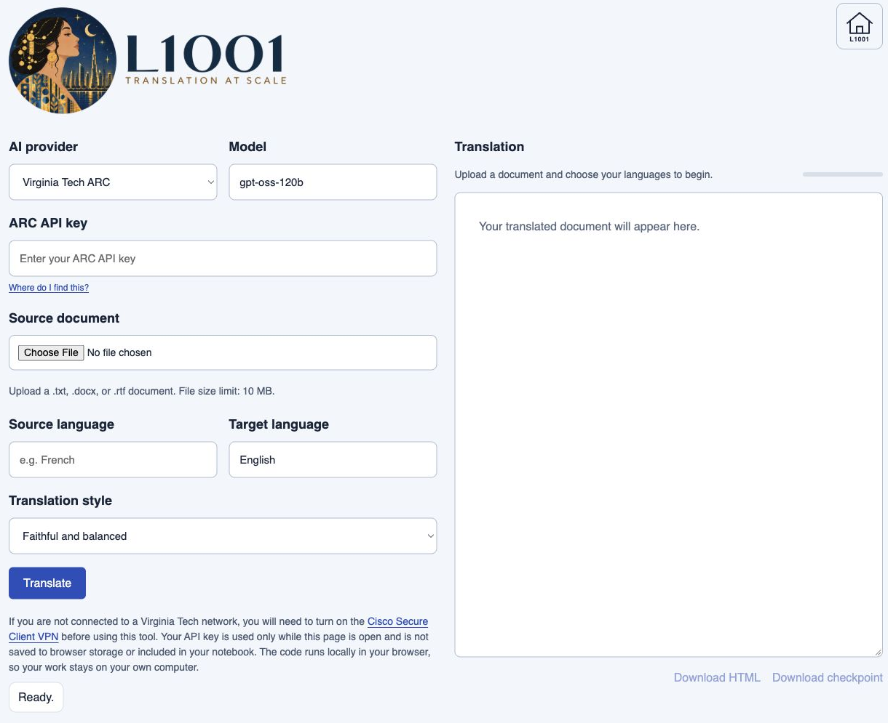
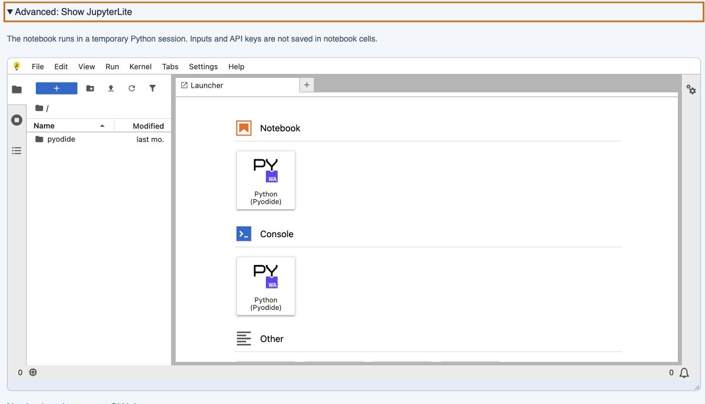

# L1001: Stateful Long-Document Translation in a Browser and Command Line

William Taggart  
Modern and Classical Languages and Literatures, Virginia Tech  
wtaggart@vt.edu

November 14, 2026

## Abstract

L1001 translates long documents through sequential language-model requests while carrying continuity information, reconciling annotations, and saving recoverable progress. Its browser interface runs a Python translation adapter in JupyterLite and exports sanitized HTML; a separate command-line implementation supports local Python workflows. This report describes segmentation, context propagation, entity registries, provider-specific requests, checkpoint validation, and document-security boundaries. Interface captures document configuration and recovery controls without implying a measured translation-quality result.

## Purpose and Research Context

Long-document translation depends on decisions that persist across paragraphs: names, register, tense, terminology, and repeated references. L1001 divides a source into manageable model requests while carrying a limited record of earlier decisions forward. It produces a standalone HTML translation and can attach globally reconciled endnotes to named entities and concepts. Its purpose is to support continuity across a work while exposing the limits of the context retained between requests.

Document-level translation research explains why that continuity matters. Voita, Sennrich, and Titov show that locally plausible translations can fail on deixis, ellipsis, and lexical cohesion ([Voita et al., 2019](https://doi.org/10.18653/v1/P19-1116)), and investigate monolingual document repair as a route to contextual consistency ([Voita et al., 2019](https://aclanthology.org/D19-1081/)). Karpinska and Iyyer find benefits from document-level context in literary translation while documenting persistent errors ([Karpinska et al., 2023](https://aclanthology.org/2023.wmt-1.41/)). Wang and colleagues examine context-aware prompting for document translation with large language models ([Wang et al., 2023](https://arxiv.org/abs/2304.02210)). L1001 addresses these concerns during sequential generation, using continuity information rather than treating independently translated segments as a finished document.

*Figure 1. The browser workspace before translation: provider, source document, language, style, preview, and download controls.*

The usefulness of that information depends on what the model can recover from it. Lost in the Middle finds position-dependent failures in long-context use ([Liu et al., 2023](https://arxiv.org/abs/2307.03172)), and LongBench evaluates long-context understanding across tasks and languages ([Bai et al., 2023](https://arxiv.org/abs/2308.14508)). Their relevance is methodological: increasing the input window does not establish that a glossary, summary, or checkpoint preserves the discourse information needed by a particular passage. The implementation therefore needs tests that follow references and translation decisions across segment boundaries, alongside review of individual passages.

Evaluation must also distinguish complementary signals of quality. BLEU compares modified n-gram precision against reference translations ([Papineni et al., 2002](https://doi.org/10.3115/1073083.1073135)), chrF uses character n-gram precision and recall ([Popović, 2015](https://doi.org/10.18653/v1/W15-3049)), and COMET provides a learned evaluation framework ([Rei et al., 2020](https://aclanthology.org/2020.emnlp-main.213/)). These offer potential components of an assessment, but none alone verifies literary register, cross-segment coherence, or preservation of an argument. This report describes the browser and command-line workflows, their continuity and recovery mechanisms, and their operational limits. Translation quality remains a question for bilingual human review and targeted document-level evaluation, rather than a consequence of successful generation or export.

## Two implementations and execution locations

The repository contains a Python command-line translator and a separately maintained browser adapter. Their goals overlap, but their chunking units and checkpoint formats differ. Changes to the root command-line script do not automatically update the browser implementation. A reproducible run therefore needs the implementation identity as well as its settings and source document.

The browser workspace provides file selection, source and target languages, provider selection, translation style, preview, and download controls. The seven style choices range from literal to literary or academic, with faithful and balanced, domesticated, readable, and accessible alternatives. These are instructions to the model rather than measured levels of semantic preservation.

The web interface embeds a JupyterLite deployment that runs Python in the browser. JupyterLite supports host-to-iframe communication [4]; this application's bridge additionally checks allowed parent origins and run identifiers. A temporary Pyodide kernel executes the published translation adapter. No server-side Python translator or PHP inference proxy is required. Browser execution still depends on downloading runtime assets and on the inference provider accepting the network requests.

## Extraction, segmentation, and continuity

The input formats are TXT, RTF, and DOCX. Text decoding handles UTF-8, UTF-16 with a byte-order mark, and a Windows-1252 fallback. DOCX extraction retains ordinary body text and selected heading, bold, and italic information, while tables are flattened. Images, comments, footnotes, and complex page layout are outside the supported import model. RTF extraction removes its control syntax. Browser safeguards limit uploads to 10 MB, extracted text to two million characters, and expanded DOCX XML to 20 MB.

Work title, author, source context, and translation guidance accompany the task. Each request also receives a limited tail of previous source text, previous translation, and continuity notes. Conceptually, request i uses the current source chunk and state from request i-1; its returned translation and updated notes become the next state. This avoids resending the entire work while allowing selected decisions to persist. It also introduces dependence on earlier errors: an incorrect continuity note can propagate.

The browser defaults to a maximum of 6,000 source characters per chunk and permits 1,000 to 16,000. Its segmentation is paragraph-aware and character-based. The command-line implementation uses token-based budgeting with tiktoken. A character limit is neither an output-token allowance nor a model-context guarantee, particularly across languages with different tokenization patterns.

## Structured translation and annotations

The model returns translated HTML, entity information, and continuity notes in a structured response. A deterministic entity registry reconciles local markers into global endnotes. Users can specify what to annotate and how much explanation each note should contain. Repeated references can consequently share an annotation rather than generating unrelated local numbering in every chunk.

Registry matching is a consistency heuristic. It cannot prove that two names denote the same person, that a note is historically accurate, or that a translated ambiguity was preserved. The application also sanitizes generated and checkpoint-loaded HTML with an allowlist, displays the preview in a sandbox, and gives downloaded HTML a restrictive content-security policy. These controls restrict executable markup; they do not validate the translation's claims.

## Providers, retries, and recovery

The browser adapter supports OpenAI Responses with structured output and ARC's streamed Chat Completions endpoint. The inspected browser configuration selects gpt-6-luna or gpt-oss-120b by default. Model availability and quotas are controlled by the provider, and the command-line defaults may differ. Provider-specific request settings and timeouts accommodate different response formats rather than implying identical capabilities.

Temporary network, service, and malformed-response failures can trigger up to six attempts, with retry guidance honored when exposed by the provider. Authentication and oversized-request failures require corrective action rather than repeating the same request indefinitely. If an output budget is exhausted, reducing source chunk size is more meaningful than treating a partial response as a complete translation. Retry behavior can incur additional usage.

After a completed chunk, the preview and recoverable state are updated. A downloaded checkpoint stores translated content, settings, registry, and continuity information, while omitting the API key and original source. Resume requires the original source document and a newly supplied key. Source and settings checks use SHA-256-based verification to prevent an accidental continuation with a different work or configuration. Browser checkpoints are not interchangeable with command-line checkpoints.

The user must download a checkpoint before closing the page to preserve that recoverable file. Stopping shuts down the working kernel; completed chunks remain visible in the current page, but cancellation cannot promise that a remote provider immediately stops billing or generation. A checkpoint is sensitive because it contains translated text even though it excludes credentials.

## Notebook access and deployment

An advanced panel exposes the embedded JupyterLite workspace for inspection. The normal translation controls remain the primary interface; users need not manually execute notebook cells. The deployment separates the host page from the runtime site, so both the published adapter and bridge configuration must be updated coherently. Runtime and package caching may occur in the browser even though form inputs are not deliberately stored as notebook cells or application database records.

*Figure 2. The embedded JupyterLite workspace runs browser-side Python in a temporary kernel.*

The browser keeps extraction and orchestration local, but the chosen provider receives source chunks and continuity context. It would therefore be inaccurate to describe the entire workflow as local or offline translation. The command-line path additionally requires a compatible Python environment and its documented packages. Both routes require authorized provider access for inference.

## Evidence and limitations

This report describes inspected code and the opened browser interface. The figures show the initial translation workspace and the embedded notebook interface, not benchmark outputs. Repository fixtures and mocked-provider tests exercise selected parsing and control paths; they are not evidence that a particular model preserves literary meaning. No new bilingual study or throughput measurement is claimed.

A useful evaluation should separate sentence accuracy, long-range consistency, entity-note correctness, style, formatting retention, and interruption recovery. It should also compare browser and command-line settings using their actual segmentation units. Limited context, uncertain annotations, unsupported source layout, provider changes, and propagated continuity errors remain practical constraints requiring human review.

## AI disclosure

This project was created with assistance from GPT-6 Astra and Codex. AI tools assisted with implementation and with drafting, checking, and formatting this report. William Taggart directed the project. This disclosure does not imply independent human validation of every generated statement; the implementation and cited sources remain available for review.

## References

1. Marzena Karpinska, Mohit Iyyer (2023). [Large Language Models Effectively Leverage Document-level Context for Literary Translation, but Critical Errors Persist](https://aclanthology.org/2023.wmt-1.41/). Proceedings of WMT; doi:10.18653/v1/2023.wmt-1.41.

2. Elena Voita, Rico Sennrich, Ivan Titov (2019). [Context-Aware Monolingual Repair for Neural Machine Translation](https://aclanthology.org/D19-1081/). Proceedings of EMNLP-IJCNLP; doi:10.18653/v1/D19-1081.

3. Ricardo Rei, Craig Stewart, Ana C. Farinha, Alon Lavie (2020). [COMET: A Neural Framework for MT Evaluation](https://aclanthology.org/2020.emnlp-main.213/). Proceedings of EMNLP; doi:10.18653/v1/2020.emnlp-main.213.

4. Project Jupyter (2026). [Communication between a host page and a JupyterLite instance running in an IFrame](https://jupyterlite.readthedocs.io/en/stable/howto/configure/advanced/iframe.html). JupyterLite documentation, accessed November 14, 2026.
5. Elena Voita, Rico Sennrich, Ivan Titov (2019). [When a Good Translation is Wrong in Context: Context-Aware Machine Translation Improves on Deixis, Ellipsis, and Lexical Cohesion](https://doi.org/10.18653/v1/P19-1116). Proceedings of the 57th Annual Meeting of the Association for Computational Linguistics. DOI: 10.18653/v1/P19-1116.

6. Wang, Longyue, Lyu, Chenyang, Ji, Tianbo, Zhang, Zhirui, Yu, Dian, Shi, Shuming, Tu, Zhaopeng (2023). [Document-Level Machine Translation with Large Language Models](https://arxiv.org/abs/2304.02210). DOI: 10.48550/arXiv.2304.02210.

7. Liu, Nelson F., Lin, Kevin, Hewitt, John, Paranjape, Ashwin, Bevilacqua, Michele, Petroni, Fabio, Liang, Percy (2023). [Lost in the Middle: How Language Models Use Long Contexts](https://arxiv.org/abs/2307.03172). DOI: 10.48550/arXiv.2307.03172.

8. Bai, Yushi, Lv, Xin, Zhang, Jiajie, Lyu, Hongchang, Tang, Jiankai, Huang, Zhidian, Du, Zhengxiao, Liu, Xiao, Zeng, Aohan, Hou, Lei, Dong, Yuxiao, Tang, Jie, Li, Juanzi (2023). [LongBench: A Bilingual, Multitask Benchmark for Long Context Understanding](https://arxiv.org/abs/2308.14508). DOI: 10.48550/arXiv.2308.14508.

9. Kishore Papineni, Salim Roukos, Todd Ward, Wei-Jing Zhu (2002). [Bleu: a Method for Automatic Evaluation of Machine Translation](https://doi.org/10.3115/1073083.1073135). Proceedings of the 40th Annual Meeting of the Association for Computational Linguistics. DOI: 10.3115/1073083.1073135.

10. Maja Popović (2015). [chrF: character n-gram F-score for automatic MT evaluation](https://doi.org/10.18653/v1/W15-3049). Proceedings of the Tenth Workshop on Statistical Machine Translation. DOI: 10.18653/v1/W15-3049.

